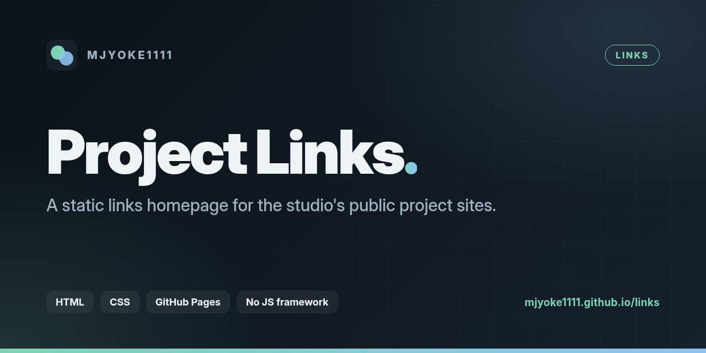
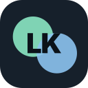
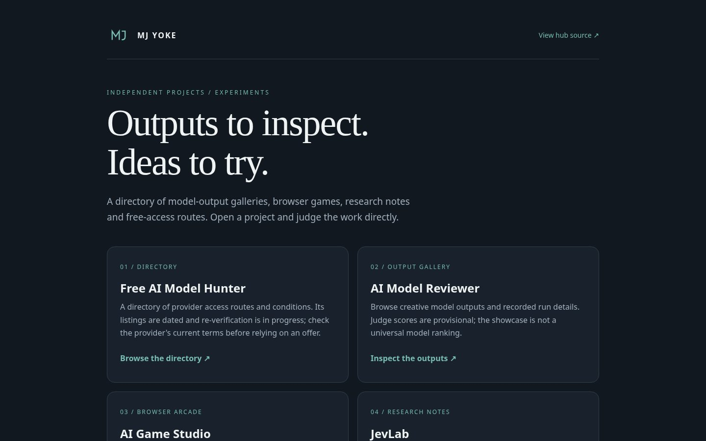

<div align="center">



<br>



# Project Links

**A static links homepage for the studio's public project sites.**

<a href="https://mjyoke1111.github.io/links/"></a> <a href="LICENSE"></a>

<a href="https://mjyoke1111.github.io/links/"><b>Live site</b></a>

</div>

## Overview

Project Links is a single static page that points to every public project site: the AI Model Reviewer, AI Game Studio, JevLab and the Free AI Model Hunter directory, each with a one-line note on what it is and what has been checked. It is served from GitHub Pages with no build step.

## Screenshots

<p align="center"><br><sub>The live links page</sub></p>

## Documentation

A static links homepage for public project sites.

[Open the hub](https://mjyoke1111.github.io/links/)

### Projects

- [Free AI Model Hunter](https://free-ai-model-hunter.vercel.app/): provider access directory. Terms and availability need current provider checks.
- [AI Model Reviewer](https://mr.mjyoke1111.biz.id/): creative-output gallery and recorded run details. Judge scores are provisional, not a universal ranking.
- [AI Game Studio](https://games.mjyoke1111.biz.id/): browser games and build records. Device support varies.
- [JevLab](https://jev.lab.mjyoke1111.biz.id/): experiment methods and recorded-answer replays.

Links were opened during a browser check on 11 October 2026. That check confirms these pages were reachable, not every feature, claim or result. Read JevLab's methods and source evidence before using a result.

### Local preview

```bash
python3 -m http.server 8000 --bind 127.0.0.1
```

Open `http://127.0.0.1:8000`. This is a static HTML/CSS site with an original SVG mark and no runtime dependency, account, API key or model call. External project links open in a new tab.

### Scope

This repository publishes the hub only. It does not publish the linked products' source or grant rights to their content. Keep keys, credentials and private files out of this repository. Review each project's own evidence and limitations before relying on it.

## What's new this week

3 commits landed between 19 and 26 October 2026. Highlights, newest first:

- Add Apache-2.0 licence; update README licence section and badge (`d1266a1`)
- docs: professional README homepage with banner, logo and badges (`5dcd667`)
- docs: point links to custom domains (`45d6df6`)

## Install

There is no build step and nothing to install. Clone the repository and preview it locally (see [Local preview](#local-preview)):

```bash
git clone https://github.com/mjyoke1111/links.git
cd links
python3 -m http.server 8000 --bind 127.0.0.1
```

## Usage

- **Visit:** the live page is at [mjyoke1111.github.io/links](https://mjyoke1111.github.io/links/).
- **Add or edit a project:** change its entry in `index.html` (name, link and one-line note), preview locally, then open a pull request. GitHub Pages republishes the page once the change is merged.
- **How it fits together:** see [docs/ARCHITECTURE.md](docs/ARCHITECTURE.md).

## Tech stack

| Layer | Technology |
|---|---|
| Site | Static HTML and CSS |
| Hosting | GitHub Pages |

## Contributing

This is a studio repository maintained by its owner and the studio's agents. Open an issue to report a problem or suggest a change; for code or content changes, open a pull request from a feature branch against the default branch with a short description of what changed and how it was checked. Keep secrets, tokens and personal data out of commits (every change is scanned with gitleaks).

## Licence

Licensed under the [Apache License, Version 2.0](LICENSE). Copyright 2026 mjyoke1111; see [NOTICE](NOTICE).

<div align="center"><sub>Part of the <a href="https://www.mjyoke1111.biz.id">mjyoke1111</a> studio.</sub></div>
